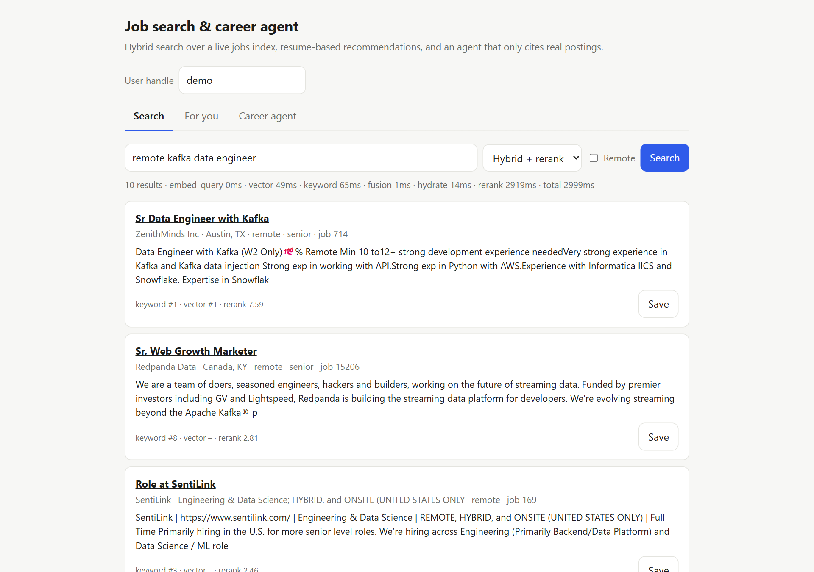
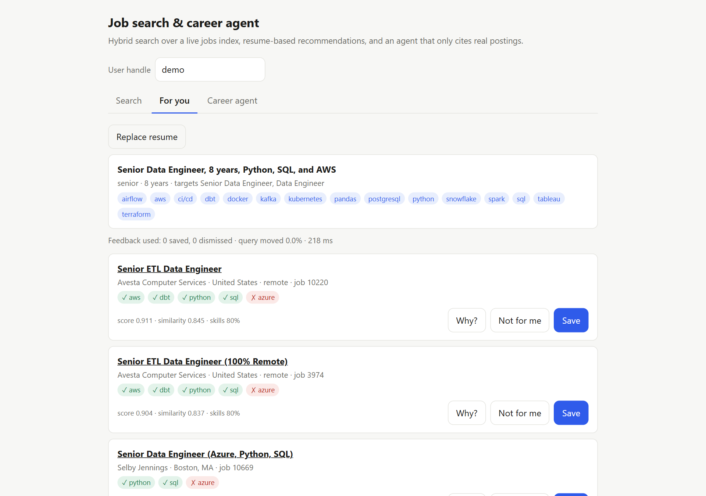
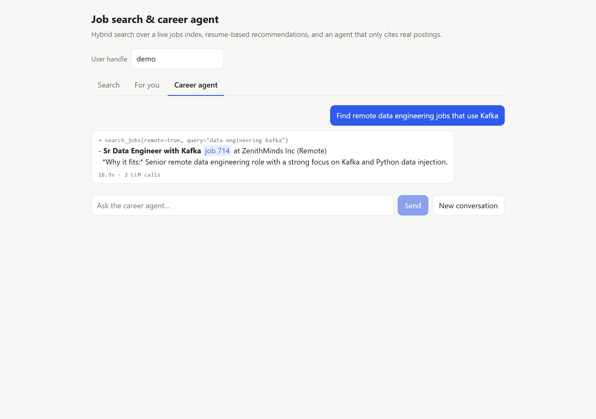

# Semantic Job Search

Semantic job search and recommendation over a continuously changing jobs index, with a career agent on top.

**Live demo:** [sjr-five.vercel.app](https://sjr-five.vercel.app) · API docs: [sjr-api-…run.app/docs](https://sjr-api-641171934531.asia-northeast1.run.app/docs) · Health: [/health](https://sjr-api-641171934531.asia-northeast1.run.app/health)

> The API scales to zero when idle, so the first request after a quiet period takes ~20–40 s while models load. The site opens as user `demo`, which has a sample data-engineer resume on file, so the **For you** tab shows recommendations immediately.

## What this project demonstrates

- **Retrieval written by hand, measured end to end.** Postgres full-text search with a BM25-style IDF, pgvector HNSW search with filters, reciprocal rank fusion and a cross-encoder reranker, with no framework wrappers. Each stage's rank, score and latency are returned with every result.
- **An index that changes.** Scheduled ingestion from three sources (Kaggle LinkedIn dump, HN "Who is hiring", Remotive), dedupe across sources, content-hash change detection so only new or changed postings are re-embedded, and expiry with a guard against partial API responses.
- **Personalisation that can be explained.** Resume → validated profile (LLM with a strict schema). Recommendations adapt to save/dismiss feedback (Rocchio). Every "why this fits / what you're missing" claim must quote the posting and the resume, and the quotes are verified mechanically.
- **An agent with guard rails.** A hand-built LangGraph state machine with 9 tools, Postgres-backed conversation memory, long-term user facts and streaming. A citation check stops it from mentioning a job that no tool returned.
- **Evals that gate changes.** Recall@10 / MRR / nDCG@10 per search mode on 110 labelled queries; 36 scripted agent scenarios scored on tool choice and arguments plus an LLM judge for groundedness. All of it runs in CI against a real Postgres.
- **Production basics.** FastAPI with request ids, JSON logs, rate limits, timeouts and caching; Langfuse tracing; Docker; deployed on Supabase, Cloud Run and Vercel with auto-deploy and a 3×/day index refresh.

**Headline numbers**

| | |
|---|---|
| Search quality, best mode (hybrid + rerank, 80 synthetic queries) | Recall@10 **0.91**, MRR@10 **0.84**, nDCG@10 **0.86** |
| Gain over keyword-only search | nDCG@10 0.55 → 0.86 |
| Agent: correct tool and arguments (36 scenarios, 41 turns) | **100%** |
| Agent answers grounded in tool output (LLM judge) | **95%** |
| Index | ~19.4k live postings, refreshed 3× a day |
| Search latency, local GPU (p50) | vector 13 ms · hybrid 56 ms · hybrid + rerank 107 ms |

## Screenshots

**Search**: hybrid + rerank, with each result's keyword rank, vector rank and rerank score, and per-stage latency (Cloud Run CPU, warm).



**For you**: profile extracted from the sample resume, recommendations with matched (✓) and missing (✗) skills, feedback buttons and "Why?" explanations.



**Career agent**: the streamed answer shows the tool call it made; `job 714` is a citation that opens the real posting.



## In plain English

*What is it?* A job search website that understands what you mean, not just the words you type, plus an assistant you can chat with about your job hunt.

*How does search work?* Ordinary search engines match words: search "ML engineer" and you miss postings that say "machine learning". This project runs two searches at once:
1. a **word search**, good for exact things like "Kafka" or a job title;
2. a **meaning search**, where every posting is turned into a list of numbers (an "embedding") that captures its meaning, and postings whose meaning is close to your query come back even when the words differ.

The two result lists are merged. Then a slower but smarter model re-reads the top 30 jobs next to your query and puts them in the best order.

*How do recommendations work?* You upload your resume. An AI reads it and writes a short structured profile: your roles, seniority, years of experience and skills. The profile is matched against every job the same way as a search. When you save jobs, future suggestions lean toward jobs like those; when you click "Not for me", they lean away. For any job you can ask "why?", and you get the reasons it fits and the skills you're missing. Each reason has to quote the actual job posting and your actual resume, and the system checks that the quotes really exist, so it can't make things up.

*What does the assistant do?* You can chat with it: "find remote data jobs", "how do I fit the second one?", "save it", "remember I only want remote roles". It uses the search and recommendation tools above to answer. It remembers the conversation, and it remembers your stated preferences across conversations. It's only allowed to mention jobs its tools actually returned; if it tries to name a job it never looked up, the answer is withdrawn and rewritten.

*How do we know it works?* By testing it like an exam:
- *Search:* 110 test searches with known good answers, scored automatically for each search method. The combined method with re-ranking finds the right job in the top 10 about 9 times out of 10.
- *Assistant:* 36 scripted conversations check that it picks the right tool with the right settings, and a second AI grades whether its answers stick to the facts.

These tests run automatically on every code change, and a change that makes search worse fails the build.

*Where does it run?*
- *Database:* jobs and their embeddings live in a Postgres database (Supabase).
- *API:* the search and AI service runs on Google Cloud Run.
- *Website:* on Vercel.
- *Updates:* every 8 hours a scheduled job pulls new postings, removes delisted ones and processes only what changed.

## Status by layer

| Layer | Status |
|---|---|
| 1. Ingestion + changing index (Postgres + pgvector) | ✅ |
| 2. Search: keyword → vector → hybrid (RRF) → cross-encoder rerank | ✅ |
| 3. Resume profile, feedback loop, grounded explanations | ✅ |
| 4. LangGraph career agent (tools, memory, streaming) | ✅ |
| 5. Retrieval + agent evals in CI | ✅ |
| 6. Production hardening, tracing, Next.js UI | ✅ |
| 7. Deployment (Supabase + Cloud Run + Vercel), auto-deploy, scheduled refresh | ✅ |

## Quickstart

```bash
docker compose up -d db                       # Postgres 17 + pgvector on localhost:5433
python -m venv .venv && .venv/Scripts/activate  # (source .venv/bin/activate on Linux/macOS)
pip install -r requirements-dev.txt
cp .env.example .env

python -m app.cli init-db
python -m app.cli ingest hn                   # HN "Who is hiring" (last 2 monthly threads, ~450 jobs)
python -m app.cli ingest remotive             # Remotive public API
python -m app.cli ingest kaggle --path data/postings.csv --limit 20000   # optional bulk data
python -m app.cli embed                       # embeds only new/changed jobs
python -m app.cli search "LLM agents and retrieval in python" --mode hybrid_rerank
python -m app.serve                           # API on :8000  (docs at /docs)

# personalised recommendations (needs GEMINI_API_KEY in .env)
python -m app.cli profile --user demo --resume examples/resume_data_engineer.md
python -m app.cli recommend --user demo
python -m app.cli feedback --user demo --job <id> --action save      # or dismiss / clear
python -m app.cli explain --user demo --job <id>
python -m app.cli chat --user demo            # career agent REPL (streams tokens + tool calls)
```

API:
- `GET /search?q=...&mode=hybrid_rerank&remote=true&seniority=senior`, `POST /search` (JSON body), `GET /health`
- `POST /users/{id}/resume` (multipart PDF/MD/TXT → profile), `GET /users/{id}/profile`
- `POST /recommend` `{"user_id": "demo", "k": 10}`, `POST /feedback` `{"user_id", "job_id", "action": "save"|"dismiss"|null}`
- `GET /users/{id}/jobs/{job_id}/explain`
- `POST /chat` `{"user_id", "thread_id", "message"}` → server-sent events; `GET /chat/{user}/{thread}`; `GET|DELETE /users/{id}/facts`

## Architecture

```
 sources (Remotive, HN Algolia, Kaggle CSV)
     │  fetch_raw → to_posting (Pydantic JobPosting)
     ▼
 pipeline: validate → dedupe → diff by content_hash → insert / update / touch → expire
     ▼
 jobs (metadata + generated tsvector)      job_embeddings (job_id, model, content_hash, vector)
     │                                            │   partial HNSW index per model
     ▼                                            ▼
 keyword (FTS, ts_rank_cd)        vector (cosine, HNSW, iterative scan + filters)
            └──────────── RRF fusion (k=60) ────────────┘
                              ▼
                cross-encoder rerank of top 30
```

## Design decisions

**Changing index**
- Every posting gets a `content_hash` (sha256 of the exact text that gets embedded). Re-ingesting classifies each row as new, changed or unchanged. A changed hash marks the job for re-embedding, and unchanged rows only get `last_seen_at` bumped. A second run of `embed` therefore does nothing.
- **Expiry** depends on the source. Snapshot sources (Remotive, HN) expire anything not seen in a successful run. A guard skips expiry if a run sees fewer than 50% of the currently active jobs, since a partial API response shouldn't delist the index. Incremental sources expire by TTL. The historical Kaggle data never expires. Rows are soft-expired (`is_active = false`), so evals and feedback history keep their foreign keys.
- **Cross-source dedupe**: `dedupe_key` = hash of normalised title|company|location. HN companies often repost across months, which accounts for the 38 duplicates on the first run.
- **Not-a-job filter** for open forums (HN). Candidates sometimes post their own pitch in "Who is hiring". Real posts also open in the first person ("I'm the founder…", "I am a recruiter at…"), so first-person openings and self-descriptions only count when no hiring signal appears anywhere (founder, recruit*, salary, equity, "our team"…). The filter is tuned for precision, because a dropped real job is invisible: on the live data it flags exactly the 5 self-promotion posts in 465, and 2 of 5,000 real LinkedIn ads in a stress test (the filter isn't applied to LinkedIn). Rejected posts are counted in `ingestion_runs.rejected` and expire through the normal snapshot path.
- Every run writes counts to `ingestion_runs` (`python -m app.cli stats`).

**Swappable embeddings**: `job_embeddings` stores vectors from several models side by side in one untyped `vector` column. Each model gets a partial expression index:
`CREATE INDEX ... USING hnsw ((embedding::vector(384)) vector_cosine_ops) WHERE model = 'bge-small'`.
Queries repeat that expression and predicate as literals so the planner can match the index. Adding a model means one `ModelSpec` line plus `embed --model <key>`. Models available: `bge-small` (default), `minilm`, `gemini` (`gemini-embedding-001`, 768d).
> At ~500 rows Postgres correctly prefers an exact scan (cheaper than HNSW). The HNSW index takes over at Kaggle scale, which you can check with `EXPLAIN`.

**Search stages**: each stage is a separate module, and each response returns every stage's rank and score plus per-stage latency.
- *Keyword (BM25-lite on Postgres FTS)*: Postgres `ts_rank` has **no IDF**. ANDing all terms matches nothing for natural queries. ORing them let words like "want" and "role" match 15.6k of 19.4k jobs, and ranking those took ~700 ms. The fix: a `lexeme_stats` table holds document frequencies (via `ts_stat`, ~1.6 s, refreshed after each ingest). Query terms found in more than 15% of jobs are dropped, and candidates are scored by Σ BM25-IDF of matched terms, with title matches counting double. Full BM25's term-frequency saturation and length normalisation are not modelled.
- *Vector*: filters plus HNSW can return too few rows, because the index returns `ef_search` neighbours before the WHERE clause runs. pgvector 0.8's `hnsw.iterative_scan = relaxed_order` keeps scanning until the limit is met, and an outer `ORDER BY` restores exact order.
- *Fusion*: RRF uses only ranks, because `ts_rank` and cosine similarity are on incomparable scales. Score = Σ 1/(60 + rank).
- *Rerank*: a cross-encoder reads query and job together, which is more accurate than a bi-encoder but too slow for the whole index, so it only rescores the fused top 30.

**Observed latency (laptop CPU, 465 jobs)**: keyword ~5 ms, vector ~6 ms, query embedding ~15–50 ms (≈0 on a cache hit), hybrid total ~70 ms, rerank ~1 s. The reranker dominates. Options are a smaller top-N, ONNX/quantised models, or a GPU.

## Data sources and terms
- **Remotive**: the public API currently lists only a handful of jobs and asks for ≤4 calls/day. Raw responses are saved to `data/raw/` and can be replayed with `--from-file`. Their terms require linking back to the Remotive URL and crediting Remotive.
- **HN Who is hiring**: hn.algolia.com, no key needed. Headers are free text, so title/location parsing is heuristic.
- **Kaggle**: [arshkon/linkedin-job-postings](https://www.kaggle.com/datasets/arshkon/linkedin-job-postings) `postings.csv`. Other CSVs work with a column mapping.

## Scheduling
`.github/workflows/refresh-index.yml` runs `python -m app.cli refresh` 3× a day against the `DATABASE_URL` secret. `ci.yml` runs ruff and pytest.

## Retrieval evals

```bash
python -m app.evals.generate --n 80      # synthetic queries (Gemini), appended to evals/retrieval/synthetic.jsonl
python -m app.evals.label                # hand-label the 30 realistic queries (interactive)
python -m app.evals.run                  # all modes; table -> evals/results/latest.md
python -m app.evals.run --models bge-small minilm gemini   # compare embedding models
```

**Two query sets**
- **Synthetic (80)**: sampled postings (70% LinkedIn, 25% HN, 5% Remotive). Gemini writes the query a job seeker would type, in three styles: `keyword` (2–5 words), `natural` (a sentence), `skills` (built around experience, not the title). The source posting is the single known-relevant result. The prompt bans the company name and verbatim titles. An audit found no company leaks; 18/80 contain the title, almost all generic ones that real users type ("Project Manager").
- **AI-judged (30 queries, 607 judgements)**: realistic queries written by hand, judged with TREC-style **pooling**. The top 10 from all four modes are merged and graded 0/1/2 by Claude against a written rubric ([`JUDGING_RUBRIC.md`](evals/retrieval/JUDGING_RUBRIC.md)), without knowing which mode returned which job. This set is *not* human-labelled. A human set can be added with `python -m app.evals.label`, which pools the same way, pre-suggests grades and has a person confirm each one. It is stored separately in `handlabeled.jsonl`.

**Metrics**: Recall@10, MRR@10, nDCG@10 (graded, exponential gain), plus p50/p95 latency.

**Known biases, stated deliberately**
- Synthetic: only the source posting counts as relevant, so other genuinely matching jobs score as misses. Absolute recall is a lower bound. Comparisons between modes are still fair because every mode faces the same handicap.
- Judged set: unjudged documents count as non-relevant (the standard pooling assumption), so recall means "recall within the judged pool". Most queries have more than 10 relevant jobs, so Recall@10 can't reach 1; read it comparatively. Judge strictness varied between the three judges (see the rubric file). That affects absolute scores, but not comparisons between modes, since every mode is scored against the same labels.
- Labels key on `source:external_id`, not the serial `jobs.id`, so the eval set survives a database rebuild. Queries whose target job has since expired are skipped and counted.

**Results** (80 synthetic queries, ~19.4k jobs, bge-small, RTX 3070; full table in [`evals/results/latest.md`](evals/results/latest.md)):

| Mode | Recall@10 | MRR@10 | nDCG@10 | p50 ms |
|---|---|---|---|---|
| keyword | 0.738 | 0.483 | 0.545 | 53 |
| vector | 0.787 | 0.702 | 0.723 | 13 |
| hybrid (RRF) | 0.838 | 0.670 | 0.711 | 56 |
| **hybrid + rerank** | **0.912** | **0.841** | **0.858** | 107 |

**What the eval caught.** The first run had keyword search at recall 0.30 / MRR 0.13 and 200 ms. Equal-weight RRF then made hybrid *worse* than vector alone (MRR 0.40 vs 0.70). Profiling found the missing-IDF problem above. After the fix, keyword search improved 2.5× in recall and 4× in speed, and hybrid now beats vector on recall (0.84 vs 0.79).

**Tuning, and resisting over-tuning.** A sweep of the DF cutoff (0.05–0.4) showed 0.25 gives better keyword-only MRR, but no gain after fusion at twice the latency, so 0.15 stays. Weighting vector 2–3× in RRF helps plain hybrid slightly but hurts hybrid+rerank, the production mode, because the reranker benefits from a more diverse top 30. Weights stay 1:1. With 80 queries, differences of about 0.03 are 2–3 queries, so they are not tuned further until the hand-labelled set exists.

**On realistic queries (AI-judged set, 30 queries):**

| Mode | Recall@10 | MRR@10 | nDCG@10 | p50 ms |
|---|---|---|---|---|
| keyword | 0.416 | 0.796 | 0.597 | 15 |
| vector | **0.604** | 0.978 | 0.803 | 11 |
| hybrid (RRF) | 0.555 | 0.967 | 0.784 | 14 |
| **hybrid + rerank** | 0.590 | **0.983** | **0.820** | 49 |

- **MRR saturates.** Realistic queries ("HR generalist") have many matching jobs, so every semantic mode nearly always puts a relevant job first. nDCG and recall are the measures that separate the modes here.
- **Hybrid+rerank still ranks best (nDCG 0.820), but vector alone is close (0.803) at a quarter of the latency.** That is a real product trade-off. A latency-sensitive endpoint, such as autocomplete or the agent's internal `search_jobs` calls, could use vector-only.
- **On short realistic queries, equal-weight RRF still lets keyword search pull hybrid below vector.** This matches the synthetic sweep, where weighting vector more helped plain hybrid. With 30 queries, differences of about 0.02 are within noise.

GPU vs CPU (i7-12650H): embedding 417 vs ~7 docs/s, rerank of 30 docs 58 ms vs ~1 s.

**Embedding model comparison** (both 384-d, same index and pipeline; switched with `--models`, no code changes):

| nDCG@10 | bge-small-en-v1.5 | all-MiniLM-L6-v2 |
|---|---|---|
| vector, synthetic | **0.723** | 0.501 |
| vector, judged | **0.803** | 0.464 |
| hybrid + rerank, synthetic | **0.858** | 0.802 |
| hybrid + rerank, judged | **0.819** | 0.722 |
| vector p50 latency | 16 ms | 14 ms |

- **bge-small wins on every set and mode, at the same latency.** Two reasons fit the data:
  - It is trained for asymmetric retrieval (short query → long passage, with a query instruction prefix). MiniLM is a general sentence-similarity model.
  - It reads 512 tokens per posting against MiniLM's 256, and the average description is ~3.7k characters (~800 tokens), so MiniLM embeds little beyond the title and the first paragraph.
- MiniLM is worst on terse keyword-style queries (MRR 0.31 vs 0.62), where the short query and the long posting are least alike.
- **The reranker narrows the gap** (vector nDCG 0.501 → 0.802 after hybrid + rerank). It reads the query and the posting together, so it recovers good jobs that a weaker first stage ranked low, as long as they reach the top 30.
- *Caveat:* the judged set's pool was built from bge-small runs. MiniLM-only results that were never judged count as non-relevant, which biases that set toward bge-small. The synthetic set (one known target per query) has no such bias and shows the same ordering.

## Recommendations (Layer 3)

```
 resume (PDF/MD) ─► Gemini ─► CandidateProfile (Pydantic, validated, retried on bad output)
                                   │  written in the shape of a job posting, embedded as a document
                                   ▼
 saved / dismissed jobs ──► Rocchio: q = 1.0·profile + 0.75·mean(saved) − 0.15·mean(dismissed)
                                   ▼
          HNSW search (same index as /search), excluding jobs already acted on
                                   ▼
 score = cosine + 0.10·skill overlap − 0.03·seniority gap  →  max 2 per company  →  top k
                                   ▼
                    on demand: grounded "why it matches / what's missing"
```

**Profile extraction.** Gemini fills a strict schema (target roles, seniority, years, skills, domains, remote preference). The prompt forbids inferring skills that aren't written down, wraps the resume in tags marked as untrusted data, and passes today's date. Without the date the model computed 5.5 years instead of 8 for "2022 – present". Free-form skills ("Apache Kafka", "Postgres 14") are mapped onto the same skill dictionary the jobs are tagged with, so overlap compares like with like.

**Profile as a document.** The profile is rendered in the same layout as a job's embedding text (title, seniority, skills, body) and embedded *without* the query prefix. A resume-to-posting match is document-to-document similarity, not a short search query.

**Feedback (Rocchio).** The textbook weights (α=1, β=0.75, γ=0.15) are used. Feedback moves toward the *centroid* of saved jobs, so ten saves of near-identical postings don't pull ten times harder. Dismissals get a smaller weight because "not this one" is noisier than "more like this". Expired jobs still count: their vectors are kept, which is one reason expiry is soft. The response reports `query_shift` (1 − cosine between the original and adjusted vectors), so you can see how much feedback moved the query. In the demo, 2 saves and 2 dismissals shifted it by 0.026, which removed the dismissed ML role and brought Kafka/Kubernetes-heavy data jobs up.

**Re-scoring.** Cosine similarity does most of the work. Skill overlap and seniority fit are small terms that re-order near-ties, and each term is returned per result. Skill overlap uses add-one smoothing: a job tagged with one skill the user has (1/1 → 0.5) shouldn't beat one where they have 5 of 5 (→ 0.83). A per-company cap exists because staffing agencies post the same role many times; before the cap, one agency held 4 of the top 10.

**Grounded explanations.** The LLM must back every "why it matches" reason with a verbatim quote from the posting *and* one from the resume, and every gap with a quote from the posting. The quotes are then checked against the exact text the model saw (case-, whitespace- and quote-insensitive substring match, with ellipsis pieces matched in order). A claim without evidence is dropped and listed in `dropped`. A gap naming a skill the profile already has is dropped as a contradiction. Explanations are cached per (user, job) and invalidated when either the profile version or the posting's `content_hash` changes.

**Latency** (warm, RTX 3070, 19.4k jobs): profile embedding ~17 ms, vector search ~5 ms, **total ~28 ms**. An explanation is one Gemini call (a few seconds, then cached).

## Career agent (Layer 4)

```
 START ─► agent ──(tool calls)──► tools ──► agent ...           (≤ 4 tool rounds per turn)
            │
            └─(answer)─► check_citations ──ok──► END
                              │
                              └─ cites a job no tool returned ─► agent  (≤ 2 retries, then struck out)
```

A hand-written LangGraph `StateGraph` (not the prebuilt ReAct agent), so the guard rails are visible graph nodes.

**Tools**: `search_jobs`, `recommend_jobs`, `get_job_details`, `parse_resume`, `skill_gap`, `save_job`, `list_saved_jobs`, `remember_fact`, `get_my_profile`. They are thin adapters over the Layer 2/3 services, and each returns compact JSON with explicit `job_id`s.
- **The user id never comes from the model.** Tools read it from the run config, so a prompt injection in a job posting can't make the agent act on another user's data. Thread ids are also namespaced by user.
- **Schema-validated tool calls with retry.** Argument schemas come from type hints (`Literal` enums for seniority and save/dismiss). Invalid arguments, unknown job ids, a missing resume or a rate-limited LLM inside a tool come back to the model as an `Error:` tool result, so it can correct itself. In testing, a 429 inside `skill_gap` produced an honest "the gap tool is rate-limited", not a failed turn.

**"No invented jobs" check.** The prompt requires every job to be cited as `[job <id>]`. `check_citations` compares those ids with the ids that tool results returned *in this thread*. A failing answer is removed from the history, the model is told which ids were invalid, and it regenerates. After 2 failed retries the bad citations are replaced with `[unverified job removed]`. Because tokens stream before the check runs, the stream emits a `retract` event so clients drop the draft.

**Memory**
- *Short-term*: the full thread is stored in Postgres by `AsyncPostgresSaver`, so a conversation survives restarts. The model sees the last 40 messages, trimmed at a user turn so tool calls stay paired with their results.
- *Long-term*: `AsyncPostgresStore` keeps facts under `("user_facts", user_id)`, and they are injected into every new thread's system prompt. Keys are a fixed vocabulary (`work_mode`, `salary_expectation`, `avoid`, …), so "now I want hybrid" overwrites "remote only" instead of contradicting it. In testing, facts given in one thread were applied as filters (`remote=true`) in a new one.

**Streaming** (`POST /chat`, SSE): `token`, `tool_call`, `tool_result`, `retract`, then `final` (answer, cited ids, token usage, latency) or `error` (`rate_limited` / `failed`).

**Testing without the network.** `build_graph` accepts an injected chat model, tools and context loader. `tests/test_agent_graph.py` runs the *real* graph with a scripted model, in-memory checkpointer and store. It covers the tool loop, citation retract/retry, striking out repeated hallucinations, tool-error recovery, thread memory and isolation,, the tool budget and retry of transient model errors. These run on every push without an API key.

**Model**: `AGENT_MODEL` (default `gemini-3.5-flash-lite`) is separate from `LLM_MODEL` (`gemini-2.5-flash`, used for profile extraction and explanations). The agent makes 2–3 LLM calls per turn, and the free tier for `gemini-2.5-flash` is 20 requests/day. A typical turn is ~2.5–5k input tokens and 1.5–15 s, depending on which tools run.

## Evals in CI (Layer 5)

```bash
python -m app.evals.fixture load                     # CI corpus into an empty DB
python -m app.evals.run --ci                         # retrieval: fails under evals/ci_thresholds.json
LLM_RPM=14 python -m app.evals.agent_eval --ci       # agent: 36 scenarios, tool checks + LLM judge
```

**CI corpus.** CI can't use the 19k-job index, so `evals/fixtures/ci_corpus.jsonl.gz` (4.6 MB) holds every job the retrieval labels point to (670), plus 1,500 seeded-random distractors, with their bge-small vectors stored as float16. CI loads it into a `pgvector` service container in seconds, with no Kaggle download and no GPU. Scores there are higher than on the full index (a 10× smaller haystack), so they serve as a **regression baseline**, not headline numbers. The mode ranking is the same as on the full index ([`ci_latest.md`](evals/results/ci_latest.md)). Floors in [`ci_thresholds.json`](evals/ci_thresholds.json) sit ~0.04 below the baseline to absorb CPU-vs-GPU numeric drift.

**Agent scenarios** ([`scenarios.jsonl`](evals/agent/scenarios.jsonl)): 36 conversations, 41 turns, across search, filters, recommendations, job details and skill gaps, save/dismiss, long-term memory, small talk and a prompt-injection attempt. Each scenario runs as a fresh user with optional setup (resume on file, remembered facts, saved jobs). Two-turn scenarios test references like "save the second one". Each turn declares:
- `tools` that must be called and `forbid` tools that must not ("hi" must not trigger a search; a search must not save anything);
- argument checks, e.g. `remote: true`, `seniority_includes: "senior"`, `location_any: ["new york", "ny"]`, `action: "dismiss"`. A remembered fact `work_mode=remote only` must show up as `remote=true` in a new thread;
- whether the answer should cite jobs.

**LLM judge.** For every answer, a judge gets the user message, every tool result in the conversation so far, and the answer. It returns a schema-validated verdict: `grounded` (every job-specific claim is supported by tool output), a list of unsupported claims, and helpfulness 1–5.

**Results** (CI corpus, agent and judge `gemini-3.5-flash-lite`; [`agent_latest.md`](evals/results/agent_latest.md)):

| Metric | Value |
|---|---|
| Turn / scenario pass rate (all deterministic checks) | 100% / 100% |
| Tool selection · argument · citation-expectation accuracy | 100% · 100% · 100% |
| Grounded (LLM judge, 40 turns) | 95% |
| Helpfulness (judge, 1–5) | 4.95 |
| Error rate · citation-guard retracts | 0% · 0% |
| LLM calls / tokens per turn | 2.0 calls, ~2.9k in / ~180 out |
| Est. cost per turn | ~$0.0004 (placeholder flash-lite prices, set in config) |
| Latency p50 / p95 | 8.7 s / 15.2 s *with free-tier throttling* (see below) |

**What the evals caught** (each led to a fix):
- *Embellished job descriptions.* The one-line "why it fits" went beyond the 200-character snippet ("focuses on data-driven innovation…"), and "Blend" became "Blend360". The prompt now limits that line to facts from the tool result. One borderline case remains in the final run (a job described as Snowflake work when its snippet doesn't say so).
- *Padding.* Asked for software engineering roles in Seattle, the agent listed a sales role and a BI role to fill the list. It is now told to drop off-target results.
- *Transient 503s from Gemini* failed a turn. The agent node now has a LangGraph `RetryPolicy` for 503/429, while other errors fail fast. This is covered by a unit test.
- *Bugs in the eval itself.* The judge first saw only the current turn's tool output, so "save the second one" answers looked ungrounded; it now sees the whole thread. A scenario demanded citations for Austin data jobs, but the CI corpus has none, and "nothing found" is the correct answer there.
- *Judge noise is real.* In the final run, one of the two "ungrounded" verdicts contradicts its own reasoning. With ~40 judged turns, a ±1-turn swing is about 2.5 points. The CI floor (90%) leaves room for that.

**Rate limits and latency.** The free tier allows 15 requests/minute per model. A shared limiter (`LLM_RPM`, one token bucket across the agent, extraction, explanations and the judge) spaces calls ~4.3 s apart rather than tripping 429s. The p50/p95 above include those waits. Unthrottled turns took 1–4 s (two model calls plus tools; retrieval is <100 ms).

**In CI** ([`ci.yml`](.github/workflows/ci.yml)): `test` runs lint, unit tests and the offline agent-graph tests on every push. `evals` loads the corpus and runs the retrieval gate on every push and PR. The agent eval runs on `main`, manual and weekly runs when the `GEMINI_API_KEY` secret is set. It is skipped on PRs and forks so free-tier quota and secrets stay safe. Reports are uploaded as build artifacts.

## Production basics (Layer 6)

```bash
python -m app.serve                         # API on :8000
cd web && npm install && npm run dev        # UI on :3000 (NEXT_PUBLIC_API_URL defaults to localhost:8000)
docker compose --profile api up --build     # or everything in containers: db + api + web
```

**UI** (`web/`, Next.js 16, no UI framework): one page with three tabs.
- *Search*: mode switcher (keyword / vector / hybrid / hybrid+rerank), each result's keyword and vector rank and rerank score, and per-stage latency, so the retrieval pipeline is visible.
- *For you*: resume upload → extracted profile and skills → recommendations with ✓ matched / ✗ missing skill chips. Save and "Not for me" re-rank immediately; the page shows how far the query moved. "Why?" shows the grounded explanation with its quotes.
- *Career agent*: streams tokens and tool calls over SSE (`fetch` plus a hand-written parser, because `EventSource` can't POST). A citation-guard `retract` discards the streamed draft. `[job N]` citations become chips that open the real posting.

**API hardening**
- *Request ids and structured logs*: every response carries `x-request-id` (taken from the caller or generated). `LOG_FORMAT=json` emits one JSON object per line with `request_id`, method, path, status, `duration_ms` and client. All log lines of a request share the id.
- *Rate limiting*: in-process token buckets per client IP and route class. 120/min by default; 10/min for endpoints that spend LLM quota (`/chat`, resume upload, explain). Exceeding the limit returns 429 with `Retry-After`. One instance only; several replicas would need Redis. `TRUST_PROXY` reads `X-Forwarded-For` only when you are behind your own proxy.
- *Timeouts*: `/search` and `/recommend` are bounded at 15 s (504). The API's Postgres pool sets `statement_timeout=10s`. CLI jobs (ingest, index builds) use an unbounded pool on purpose.
- *Caching*: identical `/search` requests come from a 60 s TTL LRU (`x-cache: hit`, ~1 ms vs ~50–900 ms). Query embeddings have their own LRU, and match explanations are cached in Postgres until the profile or posting changes.
- *Retries*: Gemini calls retry 429/5xx and invalid structured output (tenacity). The agent node retries transient errors via LangGraph `RetryPolicy`. A shared `LLM_RPM` limiter keeps all LLM calls under the provider quota.
- The middleware is plain ASGI, so streamed `/chat` responses pass through unbuffered.

**Tracing (Langfuse, optional).** Set `LANGFUSE_PUBLIC_KEY`/`LANGFUSE_SECRET_KEY` to enable it; without them every tracing call is a no-op.
- Each agent turn becomes one trace, with spans for every graph node, tool call and Gemini call (tokens, latency), tagged with the user and with the thread as the Langfuse session.
- Direct Gemini calls (profile extraction, explanations, the eval judge) are recorded as generations with token usage. A schema-validation failure is marked as a warning.
- *On Cloud Run*, the instance's CPU is throttled once a response completes, so the SDK's background exporter can't send anything until the next request. Traces are therefore flushed explicitly before each response ends. FastAPI's native OpenTelemetry request spans are turned off: they parented every agent trace and were dropped on export anyway, and with them on, traces from production never arrived in-request.

## Deployment
Supabase (Postgres + pgvector) → Google Cloud Run (API container, models baked into the image, scales to zero) → Vercel (UI). Step-by-step in [DEPLOY.md](DEPLOY.md).
- `deploy-cloudrun.yml` rebuilds and redeploys the API on every API change to `main`.
- `refresh-index.yml` keeps the hosted index fresh 3× a day.
- The local index moves to Supabase without re-embedding: `fixture build --all` exports jobs plus vectors, and `fixture load` imports them.

## Tech stack

| Area | Choice | Why |
|---|---|---|
| Database | Postgres 17 + pgvector 0.8 (HNSW, iterative scan) | One store for metadata, full-text search and vectors; filtered ANN without a second system |
| Embeddings | `BAAI/bge-small-en-v1.5` (384-d), swappable (`minilm`, `gemini-embedding-001`) | Best quality/latency in the comparison above; runs on CPU or GPU |
| Reranker | `cross-encoder/ms-marco-MiniLM-L-6-v2` | Small enough for CPU; reranks only the fused top N |
| LLM | Gemini (`gemini-3.5-flash-lite` agent, `gemini-2.5-flash` extraction/explanations by default) | Structured output with schema validation and retry |
| Agent | LangGraph `StateGraph`, `AsyncPostgresSaver`, `AsyncPostgresStore` | Explicit graph with a citation-check node; durable threads and long-term facts in the same Postgres |
| API | FastAPI, psycopg 3 async pool, SSE streaming | Async I/O end to end; plain-ASGI middleware so streams aren't buffered |
| UI | Next.js 16 (App Router), no UI framework | Small, one page, three tabs |
| Observability | JSON logs with request ids, Langfuse (OpenTelemetry) | Per-request correlation; per-turn traces with token usage |
| Infra | Docker, GitHub Actions, Supabase, Cloud Run, Vercel | CI evals, auto-deploy, scheduled refresh, scale-to-zero hosting |

## Repository layout

```
app/
  ingestion/   sources (remotive, hn_hiring, kaggle_csv), normalize (text, hashes, skills, not-a-job filter), pipeline
  embeddings/  model registry (swappable models), incremental embedding store
  search/      keyword (BM25-lite on FTS), vector (HNSW + filters), fusion (RRF), rerank, service (orchestration + timings)
  profile/     resume reading, LLM profile extraction, users/profiles/feedback storage
  recommend/   Rocchio + scoring (pure functions), recommendation service, grounded explanations
  agent/       LangGraph graph, tools, long-term memory, runtime (checkpointer, streaming)
  api/         FastAPI app, middleware (request ids, logs, rate limits)
  evals/       retrieval metrics + runner, synthetic/judged sets, labelling tool, CI fixture, agent eval + judge
  llm.py       Gemini wrapper: schema-validated output, retries, shared rate limiter
  tracing.py   optional Langfuse tracing
db/schema.sql  idempotent schema (jobs, embeddings, users, feedback, explanations, stats)
evals/         query sets, agent scenarios, CI thresholds, CI corpus fixture, latest results
web/           Next.js UI
tests/         unit tests + offline agent-graph tests
DEPLOY.md      step-by-step deployment
```

## Testing

```bash
pytest -q                                  # 59 tests, no network or DB needed
ruff check .
python -m app.evals.run                    # retrieval eval on your local index
python -m app.evals.run --ci               # on the CI corpus, with regression floors
LLM_RPM=14 python -m app.evals.agent_eval  # agent scenarios + LLM judge (needs GEMINI_API_KEY)
```

- *Unit tests* cover hashing, normalisation, the not-a-job filter, metrics, RRF, Rocchio and scoring, the grounding checker, middleware (rate limits, request ids) and the eval scoring.
- *Agent-graph tests* run the **real** LangGraph graph with a scripted chat model and in-memory persistence. They cover tool loops, citation retract/retry, tool errors, memory, thread isolation, the tool budget and transient-error retries.

## Configuration reference

All settings are environment variables (or `.env`), defined in [`app/config.py`](app/config.py). The main ones:

| Variable | Default | Purpose |
|---|---|---|
| `DATABASE_URL` | local Docker DB | Postgres connection string |
| `GEMINI_API_KEY` | none | Enables profile extraction, explanations and the agent (search works without it) |
| `LLM_MODEL` / `AGENT_MODEL` | `gemini-2.5-flash` / `gemini-3.5-flash-lite` | Models for direct calls and for the agent |
| `LLM_RPM` | unset | Shared requests-per-minute cap across all LLM calls |
| `EMBEDDING_MODEL` | `bge-small` | Key from the model registry |
| `DEVICE` | `auto` | `cuda` / `cpu` / `auto` |
| `RERANK_TOP_N`, `RERANK_MAX_TOKENS` | 30, 384 | How much the cross-encoder reads |
| `KEYWORD_MAX_DF`, `RRF_K`, `RRF_W_KEYWORD`, `RRF_W_VECTOR` | 0.15, 60, 1, 1 | Keyword and fusion tuning |
| `ROCCHIO_ALPHA/BETA/GAMMA` | 1.0 / 0.75 / 0.15 | Feedback weights |
| `RATE_LIMIT_PER_MIN`, `RATE_LIMIT_LLM_PER_MIN` | 120, 10 | Per-IP API limits |
| `REQUEST_TIMEOUT_S`, `DB_STATEMENT_TIMEOUT_MS` | 15, 10000 | Timeouts |
| `CORS_ORIGINS` | `["http://localhost:3000"]` | Allowed browser origins (JSON list) |
| `LOG_FORMAT` | `text` | `json` for one JSON object per line |
| `LANGFUSE_PUBLIC_KEY`, `LANGFUSE_SECRET_KEY`, `LANGFUSE_HOST` | unset | Enable tracing |

## Limitations and what I'd do next

- **Labels.** The realistic query set is graded by an LLM judge against a written rubric, not by people. The labelling tool for human grades exists (`python -m app.evals.label`) and stores them separately.
- **Synthetic queries have one known answer each**, so absolute recall is a lower bound. Comparisons between modes are fair, but the absolute numbers understate quality.
- **Skill tagging is a small dictionary** (~60 skills). Overlap scores and "missing skills" miss the long tail; an LLM or embedding-based skill extractor at ingestion time would fix this.
- **Free-tier constraints.** The hosted demo uses free Gemini quotas, so the agent can be rate-limited at busy times. CPU-only hosting makes reranked search ~2–3 s, versus ~0.1 s on a GPU. Cold starts take ~20–40 s.
- **Single instance.** Rate limits and the search cache live in process memory (`--max-instances 1`); several replicas would need Redis.
- **No authentication.** User handles are free text, suitable for a demo only. A real deployment needs auth before storing resumes.
- **Next steps:**
  - learning-to-rank on click/save signals;
  - tune RRF weights per query type (short keyword queries vs natural sentences);
  - an ONNX or quantised reranker for cheaper CPU serving;
  - grow the human-labelled set to tune against.
